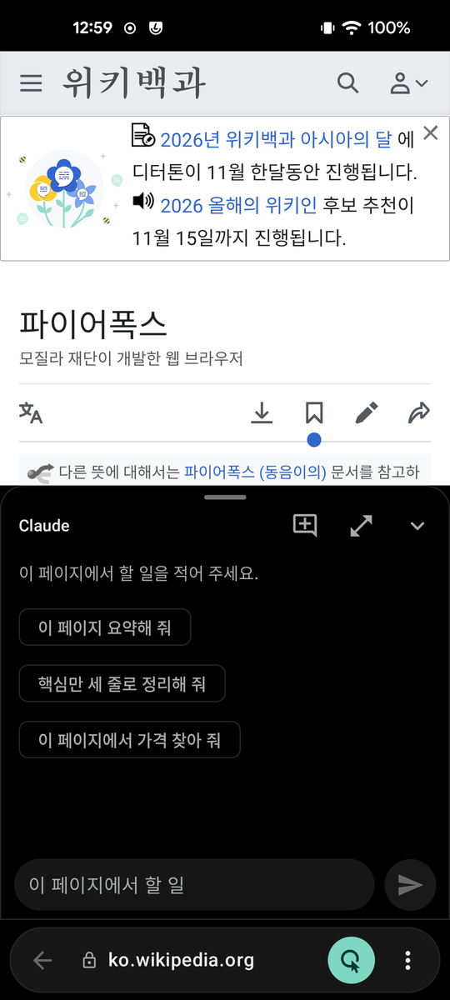
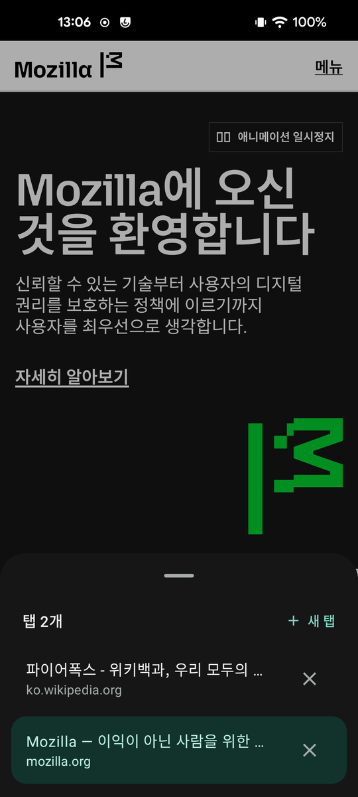
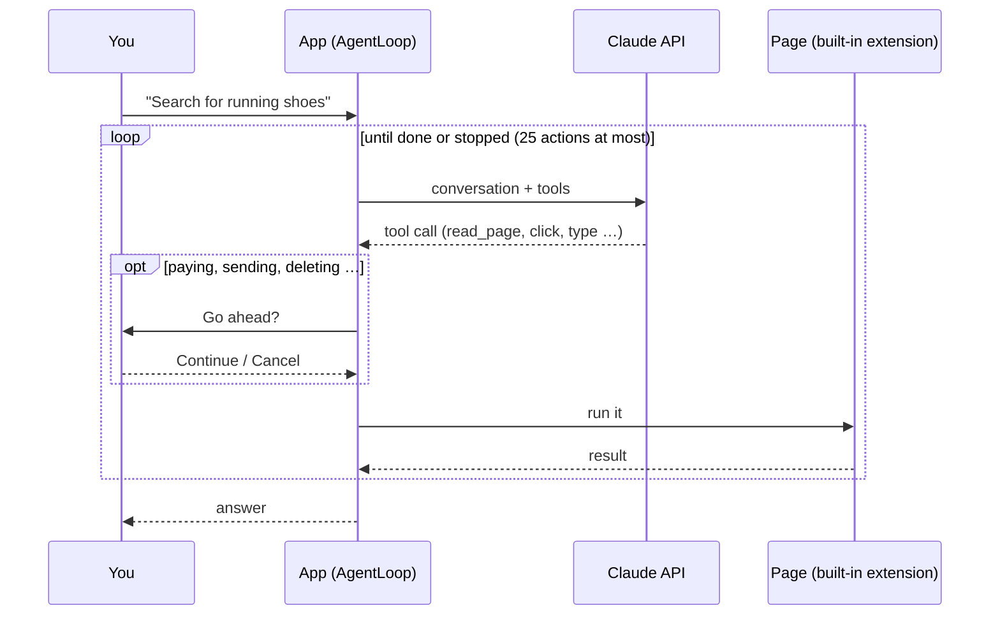

<div align="center">


# Agentic Browser

**An Android browser you can hand over to Claude.**<br>
It reads the page, clicks, types and navigates for you.

**English** · [한국어](#한국어)

[](https://github.com/HPotty36/claude-android-browser/releases/latest)
[](LICENSE)


&nbsp;
&nbsp;


[Install](#install) · [Usage](#usage) · [How it works](#how-it-works) · [Safety](#safety) · [Build](#build)

</div>

---

On a desktop you can hand browser work to Claude. On a phone there has been no good way to. This app is an ordinary browser until you tap the ring-shaped **Claude button** in the bottom bar and type something like "Summarize this page" or "Search for running shoes". All it needs is an Anthropic API key; there is no server in between.

> [!NOTE]
> A personal project. It is unofficial and not affiliated with Anthropic. API usage is billed to your own account.

## Features

| | |
| --- | --- |
| **Page control** | Read, click, type, scroll, navigate, screenshot. The page wears a teal border while Claude has the controls. |
| **Confirmation** | Paying, ordering, sending, deleting and changing account settings run only after you tap Continue. |
| **Resizable panel** | Drag the top of the Claude panel to any height. Pull it to the top, or tap the button, for full screen. |
| **Always stoppable** | A stop button stays on screen while Claude works, and one request is capped at 25 actions. |
| **One-handed** | The address, back, forward, bookmark, Claude, tabs and menu all sit in one bar at the bottom. |
| **Tabs** | Keep several pages open; switch or close them from the list. Links that ask for a new window open a new tab. |
| **Search** | DuckDuckGo by default; Google, Naver, Bing and Brave Search in settings. |
| **Google sign-in** | Built on the Firefox engine (GeckoView), so the Google sign-in that WebView apps are refused works. |
| **Import from Chrome** | Bookmarks (HTML) and passwords (CSV), with saved logins filled in on sign-in pages. |
| **Kept on the device** | The API key and passwords are encrypted with an Android Keystore key and never leave the phone. |
| **English and Korean** | Follows the system language, or pick one in settings. Claude answers in the same language. |

## Install

1. Download `agentic-browser-*.apk` from the [latest release](https://github.com/HPotty36/claude-android-browser/releases/latest).
2. Open the file on your phone. The first time, Android asks you to allow installs from that source.

Runs on arm64 devices with Android 8.0 or later. The APK is about 100 MB because it carries the browser engine.

## Usage

1. Save your key under **Settings → Anthropic API key**. Keys are created in the [Claude Console](https://console.anthropic.com/).
2. Tap the ring-shaped **Claude button** in the bottom bar and type a task.
3. When an action needs confirming, choose Continue or Cancel on the bar that appears.

Bring your Chrome data over under **Settings → Import from Chrome**.

- **Bookmarks:** the HTML file from ⋮ > Export bookmarks in the bookmark manager of Chrome on a computer
- **Passwords:** the CSV file from Chrome Settings > Google Password Manager > Settings > Export passwords. Delete the CSV once it is imported.

Nothing syncs. Changes made in Chrome later need importing again.

## How it works



Claude is sent a numbered text list of the buttons, links and inputs rather than screenshots. It costs fewer tokens and clicks land where they should.

```
[1] link "Log in"
[2] textbox "Search" value=""
[3] button "Search"
--- page text ---
…
```

| Where | What |
| --- | --- |
| `browser/` | Tabs, GeckoView sessions and the browser screen |
| `assets/agent/` | The built-in extension that reads and operates the page |
| `page/` | `PageDriver`, which talks to the extension |
| `agent/` | API client, tool definitions, the action loop, the confirmation check |
| `chat/` | The Claude panel |
| `bookmarks/`, `passwords/` | Chrome file parsers, storage, autofill |
| `settings/` | Encrypted API key, model, search engine, language, import |
| `ui/` | Theme and every string in both languages |

## Safety

- **Passwords never reach Claude.** The value of a password field is always blanked in what Claude reads, and such a page is never captured. Claude cannot type into a password field and has no tool that reads saved passwords.
- **Confirmation has two layers.** An action is confirmed when Claude marks it risky, and also when the button's label says pay, order, send, delete or the like.
- **Text on the page is not treated as instructions.** No defence against prompt injection is complete, so on accounts that matter, read the confirmation before you continue.
- **Page content is sent to the Anthropic API only while Claude is working** on your request.

## Known limits

- No history, download manager or ad blocking. Open tabs are gone when the app is closed.
- Claude works in the tab you are looking at. Switch tabs mid-task and it carries on in the new one.
- JavaScript alert/confirm dialogs, `<select>` dropdowns and file pickers do not appear.
- `intent://` links that open a login or payment app are not handled.
- Claude cannot read or operate elements inside iframes.
- Password autofill and the import screens are covered by automated tests down to storage; they have not had much use on real sites.

## Build

Android Studio (with its bundled JBR) is required. Missing SDK platforms download on the first build.

```bash
./gradlew :app:installDebug              # install on a connected phone
./gradlew :app:testDebugUnitTest         # unit tests
./gradlew :app:connectedDebugAndroidTest # tests that run on the phone
./gradlew :app:assembleRelease           # release APK
```

Debug builds install as a separate app, `dev.agentbrowser.debug`, and leave the data of a release install alone. Release signing reads `keystore.properties` in the project root (`storeFile`, `storePassword`, `keyAlias`, `keyPassword`); without it the debug key is used.

<details>
<summary><code>Unable to establish loopback connection</code> on Windows</summary>

The temp folder path is the problem. Point `TEMP` and `TMP` at a path without spaces or non-ASCII characters, set the following, and run again.

```
JAVA_TOOL_OPTIONS=-Djdk.net.unixdomain.tmpdir=<path> -Djava.io.tmpdir=<path>
```

</details>

## License

[MIT](LICENSE). The browser engine, [GeckoView](https://mozilla.github.io/geckoview/), is under the Mozilla Public License 2.0.

---

<div align="center">

# 한국어

**Claude가 페이지를 읽고 대신 조작해 주는 안드로이드 브라우저**

[English](#agentic-browser) · **한국어**

[설치](#설치) · [쓰는 법](#쓰는-법) · [동작 방식](#동작-방식) · [안전장치](#안전장치) · [직접 빌드](#직접-빌드)

</div>

앱 이름은 **에이전틱 브라우저**입니다. 데스크톱에서는 브라우저 작업을 Claude에게 맡길 수 있지만 폰에서는 방법이 마땅치 않습니다. 이 앱은 평소에는 평범한 브라우저이고, 필요할 때 하단 바의 고리 모양 **Claude 버튼**을 눌러 "이 페이지 요약해 줘", "운동화 검색해 줘"처럼 시키면 됩니다. Anthropic API 키만 있으면 되고 별도 서버는 없습니다.

> [!NOTE]
> 개인 프로젝트이며 Anthropic과 관련이 없는 비공식 앱입니다. API 사용 요금은 본인 계정에 청구됩니다.

## 기능

| | |
| --- | --- |
| **페이지 조작** | 읽기, 클릭, 입력, 스크롤, 이동, 화면 캡처. Claude가 조작하는 동안 페이지에 청록색 테두리가 둘러집니다. |
| **확인 절차** | 결제, 주문, 전송, 삭제, 계정 설정 변경은 "진행"을 눌러야 실행됩니다. |
| **패널 크기 조절** | Claude 패널의 위쪽을 끌어 원하는 높이로 조절합니다. 끝까지 올리거나 버튼을 누르면 전체 화면이 됩니다. |
| **언제든 중지** | 작업 중에는 중지 버튼이 항상 화면에 있고, 한 번의 지시에서 동작은 최대 25회입니다. |
| **한 손 조작** | 주소창과 뒤로, 앞으로, 북마크, Claude 버튼, 탭, 메뉴가 화면 아래의 바 하나에 모여 있습니다. |
| **탭** | 여러 페이지를 열어 두고 목록에서 바꾸거나 닫습니다. 새 창으로 열리는 링크는 새 탭이 됩니다. |
| **검색** | 기본 검색 엔진은 DuckDuckGo이고, 설정에서 Google, 네이버, Bing, Brave Search로 바꿀 수 있습니다. |
| **구글 로그인** | 파이어폭스 엔진(GeckoView)을 써서 WebView 앱에서 막히는 구글 로그인이 됩니다. |
| **Chrome에서 가져오기** | 북마크(HTML)와 비밀번호(CSV)를 가져오고, 로그인 화면에서 자동으로 채웁니다. |
| **기기 안에 보관** | API 키와 비밀번호는 Android Keystore 키로 암호화해 기기에만 저장합니다. |
| **한국어와 영어** | 시스템 언어를 따르거나 설정에서 고릅니다. Claude도 같은 언어로 답합니다. |

## 설치

1. [최신 릴리스](https://github.com/HPotty36/claude-android-browser/releases/latest)에서 `agentic-browser-*.apk`를 내려받습니다.
2. 폰에서 파일을 열어 설치합니다. 처음이면 "출처를 알 수 없는 앱 설치"를 허용해야 합니다.

Android 8.0 이상의 arm64 기기에서 동작합니다. 브라우저 엔진이 들어 있어 APK가 100MB 정도입니다.

## 쓰는 법

1. **설정 → Anthropic API 키**에 키를 저장합니다. 키는 [Claude Console](https://console.anthropic.com/)에서 만듭니다.
2. 하단 바의 고리 모양 **Claude 버튼**을 누르고 할 일을 적습니다.
3. 확인이 필요한 동작이 나오면 화면에 뜨는 "진행" 또는 "취소"를 고릅니다.

Chrome 데이터는 **설정 → Chrome에서 가져오기**에서 옮깁니다.

- **북마크:** PC Chrome의 북마크 관리자에서 ⋮ > 북마크 내보내기로 만든 HTML 파일
- **비밀번호:** Chrome 설정 > Google 비밀번호 관리자 > 설정 > 비밀번호 내보내기로 만든 CSV 파일. 가져온 뒤 CSV 파일은 삭제하세요.

자동 동기화는 없습니다. Chrome에서 바뀐 내용은 다시 가져와야 합니다.

## 동작 방식

흐름 다이어그램과 코드 구조는 [영어 설명](#how-it-works)과 같습니다. Claude에게는 스크린샷 대신 버튼, 링크, 입력창에 번호를 붙인 텍스트 목록을 보냅니다. 토큰이 적게 들고 클릭이 정확합니다.

## 안전장치

- **비밀번호는 Claude에게 가지 않습니다.** 비밀번호 입력창의 값은 페이지 내용에서 항상 비우고, 그런 화면은 캡처하지 않습니다. Claude는 비밀번호 입력창에 입력할 수 없고 저장된 비밀번호를 읽는 도구도 없습니다.
- **확인 절차는 두 겹입니다.** Claude가 위험하다고 표시한 동작과, 버튼 글자에 결제·주문·전송·삭제 같은 단어가 있는 동작 모두 확인을 받습니다.
- **페이지 안의 문장은 지시로 다루지 않습니다.** 다만 프롬프트 인젝션을 완전히 막는 방법은 없으므로, 중요한 계정에서는 확인 창의 내용을 읽고 진행하세요.
- **페이지 내용은 Claude에게 시킨 동안에만** Anthropic API로 전송됩니다.

## 알려진 한계

- 방문 기록, 다운로드 관리, 광고 차단이 없습니다. 열어 둔 탭은 앱을 종료하면 사라집니다.
- Claude는 지금 보고 있는 탭에서만 동작합니다. 작업 중에 탭을 바꾸면 바꾼 탭에서 이어 갑니다.
- 자바스크립트 alert/confirm, `<select>` 드롭다운, 파일 업로드 선택 창이 뜨지 않습니다.
- 카카오 로그인이나 결제 앱을 부르는 `intent://` 링크를 처리하지 않습니다.
- iframe 안의 요소는 Claude가 읽거나 조작하지 못합니다.
- 비밀번호 자동 입력과 가져오기 화면은 자동 테스트로 저장소까지만 검증했고, 실제 사이트에서의 동작은 충분히 써 보지 못했습니다.

## 직접 빌드

명령과 서명 설정은 [영어 설명](#build)과 같습니다. 디버그 빌드는 `dev.agentbrowser.debug`라는 별도 앱으로 설치되어 릴리스로 설치한 앱의 데이터를 건드리지 않습니다.

## 라이선스

[MIT](LICENSE). 브라우저 엔진 [GeckoView](https://mozilla.github.io/geckoview/)는 Mozilla Public License 2.0을 따릅니다.
