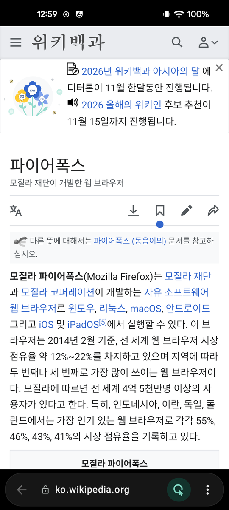
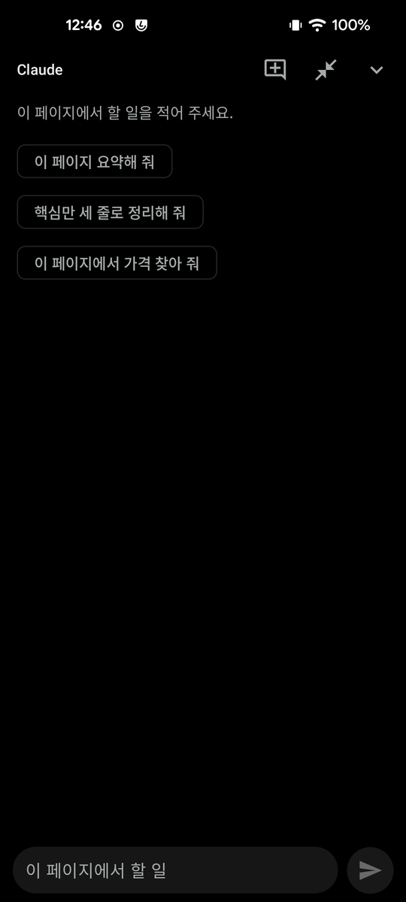
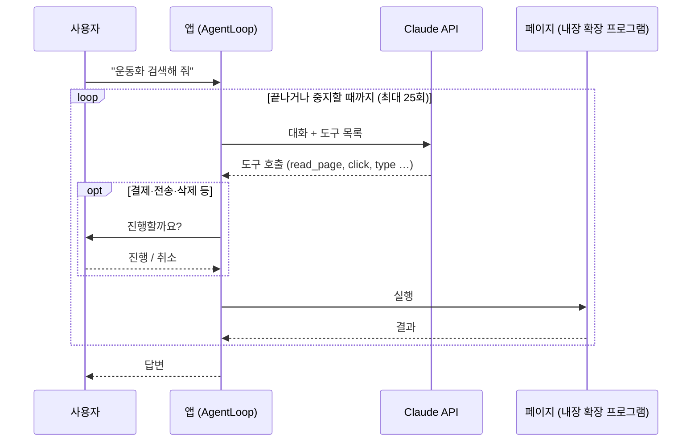

<div align="center">

# 에이전트 브라우저

**Claude가 페이지를 읽고 대신 조작해 주는 안드로이드 브라우저**

An Android browser you can hand over to Claude: it reads the page, clicks, types and navigates for you.

[](https://github.com/HPotty36/claude-android-browser/releases/latest)
[](LICENSE)


&nbsp;
&nbsp;


[내려받기](#설치) · [쓰는 법](#쓰는-법) · [동작 방식](#동작-방식) · [안전장치](#안전장치) · [직접 빌드](#직접-빌드)

</div>

---

데스크톱에서는 브라우저 작업을 Claude에게 맡길 수 있지만 폰에서는 방법이 마땅치 않습니다. 이 앱은 평소에는 평범한 브라우저이고, 필요할 때 하단의 **Claude** 버튼을 눌러 "이 페이지 요약해 줘", "운동화 검색해 줘"처럼 시키면 됩니다. Anthropic API 키만 있으면 되고 별도 서버는 없습니다.

> [!NOTE]
> 개인 프로젝트이며 Anthropic과 관련이 없는 비공식 앱입니다. API 사용 요금은 본인 계정에 청구됩니다.

## 기능

| | |
| --- | --- |
| **페이지 조작** | 읽기, 클릭, 입력, 스크롤, 이동, 화면 캡처. 지금 건드리는 요소에 테두리가 표시됩니다. |
| **확인 절차** | 결제, 주문, 전송, 삭제, 계정 설정 변경은 "진행"을 눌러야 실행됩니다. |
| **패널 크기 조절** | Claude 패널의 위쪽을 끌어 원하는 높이로 조절합니다. 끝까지 올리거나 버튼을 누르면 전체 화면이 됩니다. |
| **언제든 중지** | 작업 중에는 중지 버튼이 항상 화면에 있고, 한 번의 지시에서 동작은 최대 25회입니다. |
| **구글 로그인** | 파이어폭스 엔진(GeckoView)을 써서 WebView 앱에서 막히는 구글 로그인이 됩니다. |
| **Chrome에서 가져오기** | 북마크(HTML)와 비밀번호(CSV)를 가져오고, 로그인 화면에서 자동으로 채웁니다. |
| **기기 안에 보관** | API 키와 비밀번호는 Android Keystore 키로 암호화해 기기에만 저장합니다. |

## 설치

1. [최신 릴리스](https://github.com/HPotty36/claude-android-browser/releases/latest)에서 `agent-browser-*.apk`를 내려받습니다.
2. 폰에서 파일을 열어 설치합니다. 처음이면 "출처를 알 수 없는 앱 설치"를 허용해야 합니다.

Android 8.0 이상의 arm64 기기에서 동작합니다. 브라우저 엔진이 들어 있어 APK가 100MB 정도입니다.

## 쓰는 법

1. **설정 → Anthropic API 키**에 키를 저장합니다. 키는 [Claude Console](https://console.anthropic.com/)에서 만듭니다.
2. 하단의 **Claude** 버튼을 누르고 할 일을 적습니다.
3. 확인이 필요한 동작이 나오면 화면에 뜨는 "진행" 또는 "취소"를 고릅니다.

Chrome 데이터는 **설정 → Chrome에서 가져오기**에서 옮깁니다.

- **북마크:** PC Chrome의 북마크 관리자에서 ⋮ > 북마크 내보내기로 만든 HTML 파일
- **비밀번호:** Chrome 설정 > Google 비밀번호 관리자 > 설정 > 비밀번호 내보내기로 만든 CSV 파일. 가져온 뒤 CSV 파일은 삭제하세요.

자동 동기화는 없습니다. Chrome에서 바뀐 내용은 다시 가져와야 합니다.

## 동작 방식



Claude에게는 스크린샷 대신 버튼, 링크, 입력창에 번호를 붙인 텍스트 목록을 보냅니다. 토큰이 적게 들고 클릭이 정확합니다.

```
[1] link "로그인"
[2] textbox "검색" value=""
[3] button "검색"
--- 본문 ---
…
```

| 위치 | 역할 |
| --- | --- |
| `browser/` | GeckoView 세션과 브라우저 화면 |
| `assets/agent/` | 페이지를 읽고 조작하는 내장 확장 프로그램 |
| `page/` | 확장 프로그램과 통신하는 `PageDriver` |
| `agent/` | API 클라이언트, 도구 정의, 조작 루프, 확인 판별 |
| `chat/` | Claude 패널 |
| `bookmarks/`, `passwords/` | Chrome 파일 파서, 저장소, 자동 입력 연결 |
| `settings/` | API 키 암호화 보관, 모델 선택, 가져오기 |

## 안전장치

- **비밀번호는 Claude에게 가지 않습니다.** 비밀번호 입력창의 값은 페이지 내용에서 항상 비우고, 그런 화면은 캡처하지 않습니다. Claude는 비밀번호 입력창에 입력할 수 없고 저장된 비밀번호를 읽는 도구도 없습니다.
- **확인 절차는 두 겹입니다.** Claude가 위험하다고 표시한 동작과, 버튼 글자에 결제·주문·전송·삭제 같은 단어가 있는 동작 모두 확인을 받습니다.
- **페이지 안의 문장은 지시로 다루지 않습니다.** 다만 프롬프트 인젝션을 완전히 막는 방법은 없으므로, 중요한 계정에서는 확인 창의 내용을 읽고 진행하세요.
- **페이지 내용은 Claude에게 시킨 동안에만** Anthropic API로 전송됩니다.

## 알려진 한계

- 탭은 하나입니다. 방문 기록, 다운로드 관리, 광고 차단이 없습니다.
- 자바스크립트 alert/confirm, `<select>` 드롭다운, 파일 업로드 선택 창이 뜨지 않습니다.
- 카카오 로그인이나 결제 앱을 부르는 `intent://` 링크를 처리하지 않습니다.
- iframe 안의 요소는 Claude가 읽거나 조작하지 못합니다.
- 비밀번호 자동 입력과 가져오기 화면은 자동 테스트로 저장소까지만 검증했고, 실제 사이트에서의 동작은 충분히 써 보지 못했습니다.

## 직접 빌드

Android Studio(JBR 포함)가 필요합니다. 없는 SDK 플랫폼은 첫 빌드 때 자동으로 받습니다.

```bash
./gradlew :app:installDebug              # 연결된 폰에 설치
./gradlew :app:testDebugUnitTest         # 단위 테스트
./gradlew :app:connectedDebugAndroidTest # 폰에서 도는 테스트 (끝나면 앱을 지우므로 데이터가 사라집니다)
./gradlew :app:assembleRelease           # 릴리스 APK
```

릴리스 서명은 프로젝트 루트의 `keystore.properties`(`storeFile`, `storePassword`, `keyAlias`, `keyPassword`)를 읽습니다. 없으면 디버그 키로 서명합니다.

<details>
<summary>Windows에서 <code>Unable to establish loopback connection</code>이 날 때</summary>

임시 폴더 경로 문제입니다. `TEMP`, `TMP`를 공백과 한글이 없는 경로로 바꾸고 다음을 설정한 뒤 다시 실행하세요.

```
JAVA_TOOL_OPTIONS=-Djdk.net.unixdomain.tmpdir=<경로> -Djava.io.tmpdir=<경로>
```

</details>

## 라이선스

[MIT](LICENSE). 브라우저 엔진 [GeckoView](https://mozilla.github.io/geckoview/)는 Mozilla Public License 2.0을 따릅니다.
